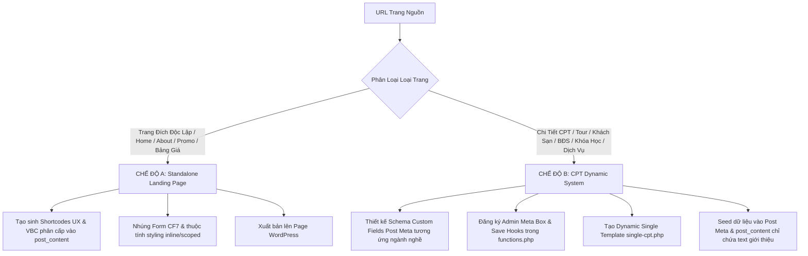

# Clone Landing Page & CPT System (Antigravity Real Browser & AI Visual Generative Architecture)

## Mục tiêu (Goal)
Sử dụng **Trình duyệt thật của Antigravity (`browser_subagent`)** để truy cập, cuộn trang kích hoạt toàn bộ lazy-load/hiệu ứng và chụp ảnh màn hình toàn trang (**Full-Page Screenshot**). 

Sau đó, **AI đóng vai trò Senior UI/UX & Fullstack WordPress Engineer** phân tích trang nguồn, trích xuất Design System (màu sắc, typography, khoảng cách) và trực tiếp quan sát ảnh chụp màn hình để **TẠO SINH 100% MÃ NGUỒN MỚI TINH BẰNG NATIVE UX ELEMENTS & VBC ELEMENTS**:
- Đối với **Trang đích độc lập (Landing Page)**: Tạo sinh hệ thống **Native Flatsome & VBC Elements** (`[section]`, `[row]`, `[col]`, `[vbc_div]`, `[vbc_box]`, `[vbc_block]`, `[vbc_h1]-[vbc_h6]`, `[vbc_p]`, `[vbc_a]`, `[vbc_img]`, `[vbc_icon]`, `[vbc_post]`, `[contact-form-7]`).
- Đối với **Hệ thống CPT & Trang Chi Tiết (Custom Post Type System)**: Thiết kế toàn diện kiến trúc **Backend (Custom Fields Schema, Admin Meta Box, REST API)** kết hợp **Frontend (Dynamic PHP Template `single-[cpt].php`, Dynamic Gallery, Sticky Conversion Sidebar, Timelines)**, tuyệt đối không dùng nội dung tĩnh.

---

> [!CRITICAL]
> ### 🚫 QUY TẮC THÉP 1: 100% DÙNG UX / VBC ELEMENTS — TUYỆT ĐỐI CẤM DỒN CODE VÀO UX TEXT
> - ❌ **TUYỆT ĐỐI CẤM (HARD BAN) dồn một khối HTML thô lớn (`<div>...</div>`) vào `post_content` của Page hoặc UX Block!**
>   - Khi bạn dồn raw HTML vào `post_content`, trình dựng Flatsome UX Builder **KHÔNG THỂ** phân tích cây DOM và sẽ tự động gói toàn bộ khối HTML đó thành **MỘT PHẦN TỬ TEXT DUY NHẤT** trên thanh điều hướng bên trái!
>   - Người dùng mở UX Builder chỉ thấy đúng 1 nút Text màu xanh, mất hoàn toàn cấu trúc Section, Row, Column, không thể kéo thả, co giãn cột hay click chọn phần tử để sửa trực quan!
> - ✅ **LUÔN LUÔN PHÂN RÃ TOÀN BỘ BỐ CỤC THÀNH CÂY PHẦN TỬ UX BUILDER & VBC ELEMENTS**:
>   - Phân khu lớn: `[section]` hoặc `[vbc_section]`.
>   - Lưới chia cột: `[row]` và `[col span="..."]`.
>   - Khối bao, card, container con: `[vbc_div]`, `[vbc_box]`, `[vbc_block]`.
>   - Tiêu đề: `[vbc_h1]` đến `[vbc_h6]` (hoặc `[title]`).
>   - Đoạn văn bản: `[vbc_p]`.
>   - Nút bấm, link: `[vbc_a]` hoặc `[button]`.
>   - Danh sách bài viết / CPT: `[vbc_post]`.
>   - Form: `[contact-form-7]`.
> - **Tiêu chuẩn nghiệm thu**: Khi mở trang hoặc UX Block trong UX Builder, thanh cây thư mục bên trái **BẮT BUỘC PHẢI THẤY ĐẦY ĐỦ CÂY PHÂN CẤP** (`Section` > `Row` > `Column` > `Elements con`). Nếu chỉ thấy 1 node `Text`, task bị tính là **THẤT BẠI HOÀN TOÀN**!

---

> [!CRITICAL]
> ### 🚫 QUY TẮC THÉP 2: ZERO-HARDCODED CSS/JS — DÙNG CHUNG CHO TOÀN BỘ MỌI WEBSITE
> - ❌ **TUYỆT ĐỐI CẤM hardcode các đoạn mã CSS tùy biến, class cố định hay JS riêng của một thương hiệu vào skill.**
> - ✅ **TẤT CẢ STYLING ĐƯỢC ÁP DỤNG TRỰC TIẾP QUA THUỘC TÍNH CỦA VBC ELEMENTS**:
>   - Màu nền: `bg_color="..."` hoặc `bg="..."`
>   - Màu chữ: `color="..."`
>   - Kích thước & Khoảng cách: `padding="..."`, `margin="..."`, `gap="..."`, `width="..."`, `height="..."`
>   - Định dạng: `font_size="..."`, `font_weight="..."`, `border_radius="..."`, `box_shadow="..."`
>   - Bố cục: `display="flex"`, `flex_direction="column"`, `align_items="..."`, `justify_content="..."`
> - Nếu một thành phần đòi hỏi hiệu ứng nâng cao (hover, pseudo-elements), sử dụng thuộc tính `custom_css="selector { ... }"` được scoped cục bộ trong chính element đó qua từ khóa `selector`. Tuyệt đối không xả CSS toàn cục bừa bãi làm vỡ giao diện các trang khác.

---

## 🏛️ Hai Chế Độ Kiến Trúc (Dual Architecture Strategy)

Trước khi thực hiện, AI Agent **BẮT BUỘC** phân loại trang nguồn thuộc một trong hai chế độ kiến trúc sau:



### 📋 Bảng Checklist Phân Loại Kiến Trúc Tiền Thực Thi (Pre-Flight Architectural Checklist)

Trước khi viết bất kỳ dòng mã nào, AI Agent **BẮT BUỘC dành 30 giây rà soát bảng checklist này** để chọn đúng đích đến, loại trừ 100% rủi ro phải viết lại code:

| Loại Trang Trong Dự Án | Chế Độ Áp Dụng | Phương Pháp Xây Dựng | Nơi Lưu Trữ Code | Tiêu Chuẩn UX Builder |
|---|---|---|---|---|
| **Trang chủ / About / Landing Page** | Chế độ A (Standalone) | 100% Cây shortcode `[section] > [row] > [col]` | `post_content` của WordPress Page | Hiện đủ Section > Row > Col, cấm dồn vào thẻ Text |
| **Chân trang (Global Footer)** | UX Block Toàn Trang | 100% Cây shortcode `[section] > [row] > [col]` | `post_content` của UX Block `footer` + `theme_mod_footer_block` | Hiện đủ 3 Section (Pillars, Links, Copyright) |
| **Danh sách (Blog List / Tour Grid / Archive)** | Dynamic Query Block | `[vbc_post post_type="..." layout="grid"]` | `post_content` của WordPress Page | Tự động truy vấn bài viết từ DB |
| **Trang chi tiết CPT (Tour / BĐS / Khóa học...)** | Chế độ B (Dynamic CPT) | PHP Template `single-[cpt].php` đọc Post Meta | File template child theme + Post Meta DB | `post_content` chỉ chứa văn bản editorial sạch |
| **Trang chi tiết Tin tức / Blog mặc định** | Child Single Template | PHP Template `single.php` đọc `the_content()` + Author/Sidebar | File template `single.php` trong child theme | Có Breadcrumbs, Author bar, 2 cột (Content + Sticky Sidebar) |


### Chế độ A: Standalone Landing Page (Trang Đích Độc Lập)
- **Áp dụng cho**: Trang chủ (Homepage), Trang giới thiệu công ty, Trang bảng giá tổng hợp, Trang sự kiện khuyến mãi đơn lẻ, Landing Page quảng cáo Google/Facebook Ads.
- **Đặc điểm**: Bố cục trang là duy nhất, toàn bộ cấu trúc được sinh trực tiếp dưới dạng cây shortcode UX Elements & VBC Elements lưu trong `post_content` của một WordPress Page.

### Chế độ B: CPT Dynamic System (Hệ Thống CPT & Trang Chi Tiết)
- **Áp dụng cho**: Chi tiết Tour du lịch, Phòng khách sạn, Bất động sản, Khóa học đào tạo, Gói dịch vụ y tế/spa, Sản phẩm đặc thù, Bác sĩ/Chuyên gia.
- **QUY TẮC SỐNG CÒN — TUYỆT ĐỐI CẤM**:
  - ❌ **CẤM nhồi nhét toàn bộ giao diện chi tiết thành một chuỗi HTML/shortcode tĩnh cứng ngắc vào `post_content` của một bài viết đơn lẻ!**
  - Làm như vậy sẽ khiến các bài viết còn lại trong CPT bị trống trơn, hỏng giao diện, và người quản trị trong WP Admin không thể chỉnh sửa giá hay thuộc tính.
- **QUY TRÌNH CHUẨN 4 BƯỚC CHO CHẾ ĐỘ B**:
  1. **Backend Schema**: Tự động thiết kế bộ Custom Fields (`_[cpt]_*`) đáp ứng đầy đủ thuộc tính của đối tượng thực tế.
  2. **Admin Meta Box**: Tự động tạo giao diện nhập liệu trực quan trong WP Admin (`add_meta_box`) và hook lưu dữ liệu (`save_post_[cpt]`) an toàn.
  3. **Frontend Dynamic Template**: Viết file template PHP động cho child theme (`single-[cpt].php`) đọc toàn bộ Custom Fields qua `get_post_meta()` với fallback thông minh.
  4. **Clean Editorial Content**: `post_content` chỉ chứa văn bản giới thiệu/editorial thuần túy từ trình soạn thảo WordPress. Mọi bài viết thuộc CPT đều tự động thừa hưởng giao diện chuẩn đẹp 100%.

---

## Quy trình Thực hiện Chi tiết (Workflow)

### Bước 1: Trình Duyệt Thật (`browser_subagent`) & Trích Xuất Design System
1. **Khởi chạy Trình duyệt thật qua Antigravity `browser_subagent`**:
   - Sử dụng tool `browser_subagent` để mở trình duyệt thật điều hướng đến `<URL_NGUON>`.
   - Mô phỏng hành vi người dùng thật: cuộn trang từ từ từ trên xuống dưới để kích hoạt toàn bộ cơ chế **Lazy Load ảnh**, **Web Fonts**, **CSS Animations** và các thành phần JavaScript động.
   - Chụp ảnh màn hình toàn trang (**Full-Page Screenshot**) lưu vào thư mục artifacts.
   - Trình duyệt Antigravity tự động ghi hình phiên duyệt web dưới dạng video WebP phục vụ kiểm chứng trực quan.

2. **Trích xuất Design System động từ Trang Nguồn**:
   - **Bảng màu (Color Palette)**:
     - `Primary Brand Color`: Màu nhận diện thương hiệu chủ đạo (nút CTA, tiêu đề nhấn mạnh, icon nổi bật).
     - `Secondary / Accent Color`: Màu bổ trợ (huy hiệu, tag khuyến mãi, đánh giá sao).
     - `Neutral / Background Colors`: Màu nền trang (`#ffffff`, xám nhạt `#f8fafc`, nền phụ `#fafafa`), màu viền (`#e2e8f0`, `#ebebeb`).
     - `Text Colors`: Màu tiêu đề đậm (`#1e293b`, `#111827`), màu nội dung (`#64748b`, `#4b5563`).
   - **Typography**: Phông chữ, độ đậm (`font_weight="800"` cho heading, `400`/`500` cho body), khoảng cách dòng (`line_height="1.6"`).
   - **Elevation & Radius**: Độ bo góc (`border_radius="8px"` hoặc `16px`), độ đổ bóng (`box_shadow="0 4px 20px rgba(0,0,0,0.06)"`).

3. **Đồng bộ Media lên WordPress Media Library**:
   - Chạy script đồng bộ ảnh:
     ```bash
     python .agents/skills/clone-landingpage/scripts/sync_media.py --url "<URL_NGUON>"
     ```
   - **Quy tắc Kiểm tra Trùng lặp trước khi upload**: Script tự động kiểm tra ảnh đã tồn tại trên WordPress Media Library hay chưa (`/vbc/v1/check-media`). Nếu đã có $\to$ tái sử dụng URL WordPress, không tạo bản sao thừa. Kết quả ánh xạ lưu tại `tmp/<slug>/media_map.json`.

---

### Bước 2 (Chế độ B): Thiết Kế Schema Custom Fields & Admin Meta Box (Backend)

Khi trang nguồn thuộc **Chế độ B (CPT Dynamic System)**, AI Agent phân tích đối tượng kinh doanh của trang nguồn để thiết kế Schema tổng quát:

#### 1. Bóc tách Schema Custom Fields chuẩn theo loại CPT:
- **Giá & Ưu đãi**: `_[cpt]_price` (giá bán hiện tại), `_[cpt]_original_price` (giá gốc gạch ngang), `_[cpt]_discount_badge` (tiết kiệm / ưu đãi).
- **Social Proof & Huy hiệu**: `_[cpt]_badge` (Huy hiệu nổi bật), `_[cpt]_rating` (sao đánh giá), `_[cpt]_reviews_count` (số lượt đánh giá), `_[cpt]_booked_count` (lượt mua / sử dụng).
- **Thông số đặc thù của ngành**:
  - *Tour / Du lịch*: `_tour_duration`, `_tour_location`, `_tour_languages`, `_tour_confirmation`, `_tour_cancellation`.
  - *Bất động sản*: `_property_area`, `_property_bedrooms`, `_property_bathrooms`, `_property_direction`, `_property_legal`.
  - *Khóa học*: `_course_lessons`, `_course_duration`, `_course_level`, `_course_certificate`.
  - *Dịch vụ / Spa*: `_service_duration`, `_service_therapist`, `_service_technique`.
- **Thư viện ảnh Gallery**: `_[cpt]_gallery` (lưu danh sách URL ảnh phụ ghép cùng ảnh đại diện Featured Image tạo thành bộ sưu tập ảnh).
- **Khối nội dung có cấu trúc**:
  - `_[cpt]_highlights`: Điểm nổi bật (danh sách gạch đầu dòng).
  - `_[cpt]_packages`: Các gói lựa chọn (Tên gói | Giá | Mô tả).
  - `_[cpt]_timeline`: Lịch trình / Quy trình / Lộ trình (Thời gian / Bước | Tiêu đề | Chi tiết).
  - `_[cpt]_included` & `_[cpt]_excluded`: Quyền lợi bao gồm & không bao gồm.
  - `_[cpt]_reviews_list`: Đánh giá khách hàng thực tế (Họ tên | Số sao | Nhận xét).

#### 2. Đăng ký Admin Meta Box trong `functions.php`:
Tích hợp giao diện quản trị trực quan trong trang chỉnh sửa bài viết của WP Admin:
```php
add_action('add_meta_boxes', function() {
    add_meta_box('{cpt}_meta_box', '⚡ Thuộc tính {CPT_NAME} (Custom Fields)', '{cpt}_render_meta_box', '{cpt}', 'normal', 'high');
});

function {cpt}_render_meta_box($post) {
    wp_nonce_field('{cpt}_save_meta_action', '{cpt}_meta_nonce');
    // Hiển thị các trường input/textarea chia theo từng nhóm trực quan:
    // 1. Giá & Khuyến mãi | 2. Đánh giá & Huy hiệu | 3. Thông số | 4. Gallery | 5. Highlights | 6. Packages | 7. Timeline | 8. Inclusions | 9. Reviews
}

add_action('save_post_{cpt}', function($post_id) {
    if (!isset($_POST['{cpt}_meta_nonce']) || !wp_verify_nonce($_POST['{cpt}_meta_nonce'], '{cpt}_save_meta_action')) return;
    if (defined('DOING_AUTOSAVE') && DOING_AUTOSAVE) return;
    if (!current_user_can('edit_post', $post_id)) return;
    // Sanitize và update_post_meta toàn bộ các trường
});
```

---

### Bước 3 (Chế độ B): Xây Dựng Template Động `single-[cpt].php` (Frontend)

Tạo file `single-[cpt].php` trong child theme mô phỏng bố cục từ ảnh chụp trang nguồn:
1. **Breadcrumbs**: Điều hướng phân cấp động theo Điểm đến / Chuyên mục / Danh mục bài viết.
2. **Thư viện ảnh trực quan (Gallery)**: Khung ảnh nổi bật (Mosaic đa ảnh hoặc Carousel slider) tự động nạp từ Featured Image và `_[cpt]_gallery`.
3. **Thanh Thông Số Nhanh (Fast Facts / Key Specs)**: Icon & thông số cốt lõi của dịch vụ/sản phẩm.
4. **Điểm Nổi Bật (Highlights)**: Danh sách tích điểm nổi bật mang màu sắc nhận diện của trang nguồn.
5. **Nội Dung Giới Thiệu**: Render `the_content()` từ trình soạn thảo WordPress.
6. **Lịch Trình / Quy Trình / Gói Dịch Vụ**: Render linh hoạt từ Post Meta có cấu trúc.
7. **Bảng Điều Khoản & Quyền Lợi**: So sánh trực quan Bao gồm vs Không bao gồm.
8. **Đánh Giá Khách Hàng (Social Proof)**: Thẻ nhận xét thật kèm sao vàng và thông tin khách hàng.
9. **Sticky Conversion Sidebar (Cố định khi cuộn)**: Khung giá ưu đãi, % tiết kiệm, nút bấm CTA nổi bật, form Contact Form 7 giữ chỗ/tư vấn và các cam kết bảo đảm.
10. **Gợi Ý Tương Tự (Related Items)**: Tự động truy vấn các mục liên quan cùng danh mục ở chân trang.

---

### Bước 4: Tự động Tạo Biểu Mẫu Contact Form 7 (BẮT BUỘC)
Khi phát hiện form nhập liệu trên trang nguồn (hoặc khu vực CTA đăng ký nhận ưu đãi/tư vấn/đặt chỗ):
1. **Phân tích các trường dữ liệu**: Bóc tách tên trường, placeholder, kiểu input (Họ tên, SĐT, Email, Dịch vụ chọn, Ngày hẹn, Ghi chú...).
2. **Chạy script sinh Form CF7 qua REST API**:
   ```bash
   python .agents/skills/clone-landingpage/scripts/create_cf7.py --title "Form Đặt Dịch Vụ - <Tên Landing Page>" --fields "name,phone,email,service,date,note" --button "Đăng Ký Ngay • Nhận Ưu Đãi"
   ```
3. **Lấy mã Shortcode trả về** dạng `[contact-form-7 id="<ID>" title="..."]` để nhúng trực tiếp vào container VBC hoặc Sidebar.
4. **Quy tắc**: 100% biểu mẫu thu thập thông tin (Lead Form) **BẮT BUỘC** phải được tạo thành form Contact Form 7 thực tế qua API, **TUYỆT ĐỐI KHÔNG** dùng văn bản giả lập tĩnh (`[vbc_p]`) thay cho form.

---

### Bước 4.1: Nhận Diện Danh Sách Bài Viết / Sản Phẩm -> Dùng `[vbc_post]`
Khi phát hiện khu vực danh sách Tin tức, Bài viết Blog, hoặc Danh sách Sản phẩm/Dịch vụ/Tour:
1. **Danh sách Tin tức / Blog**:
   ```
   [vbc_post post_type="post" posts_per_page="3" columns="3" columns__sm="1" layout="grid" image_height="220px" title_tag="h3" button_text="Xem chi tiết" card_radius="18px"]
   ```
2. **Danh sách Dịch vụ / Sản phẩm / CPT**:
   ```
   [vbc_post post_type="{cpt}" posts_per_page="4" columns="4" columns__sm="1" layout="grid" card_radius="16px"]
   ```
3. **Ưu điểm**: Tự động lấy thumbnail, tiêu đề, tóm tắt, giá bán, ngày đăng, liên kết permalink tự động và tương thích 100% với Flatsome UX Builder.

---

### Bước 4.2: Tách & Clone Footer Về Flatsome UX Block Footer (Global UX Block Footer)

> [!CRITICAL]
> **QUY TẮC BẮT BUỘC VỀ FOOTER**:
> - ❌ **TUYỆT ĐỐI CẤM dán trực tiếp footer vào `post_content` của từng trang Landing Page hay CPT.**
> - ❌ **KHÔNG hardcode footer tĩnh trong file `footer.php`** vì sẽ làm mất khả năng kéo thả của UX Builder.
> - ✅ **LUÔN LUÔN tạo một Flatsome UX Block (`post_type: 'blocks'`) với slug là `footer`**.
> - ✅ **BẮT BUỘC DỰNG BẰNG 100% SHORTCODE UX & VBC ELEMENTS**: Phân cấp rõ `[section]`, `[row]`, `[col]`, `[vbc_div]`, `[vbc_box]`, `[vbc_h4]`, `[vbc_p]`, `[vbc_a]`. Tuyệt đối không dồn thành 1 thẻ Text raw HTML!

#### 1. Bóc Tách & Thiết Kế Cấu Trúc Footer Từ Trang Nguồn:
Footer chuẩn hiện đại gồm 3 phân khu:
1. **Thanh Cam Kết Giá Trị (Brand Pillars / Key Guarantees)**:
   - 3–4 khối lợi ích nổi bật với icon, tiêu đề đậm và đoạn mô tả ngắn gọn.
   - Dựng bằng `[section]` > `[row]` > các `[col]` > `[vbc_div]` chứa `[vbc_box]` (icon) và `[vbc_h4]`, `[vbc_p]`.
2. **Khối Liên Kết Đa Cột & Tiện Ích Chân Trang (Multi-Column Navigation)**:
   - Các cột liên kết: Giới thiệu thương hiệu, Dịch vụ/Sản phẩm, Hỗ trợ/Điều khoản, Kênh thanh toán / Chứng nhận uy tín / Tải ứng dụng.
   - Dựng bằng `[section]` > `[row]` > các `[col]` > `[vbc_h4]` (tiêu đề cột) và `[vbc_div display="flex" flex_direction="column" gap="10px"]` chứa các `[vbc_a]` riêng biệt.
   - *Lưu ý*: Dùng `[vbc_div]` flex column cho danh sách liên kết thay vì `<ul>/<li>` để triệt tiêu hoàn toàn bullet dots hoặc dấu gạch ngang do theme Flatsome áp đặt.
3. **Thanh Bản Quyền & Mạng Xã Hội (Copyright & Social Bar)**:
   - Dòng bản quyền doanh nghiệp kèm các nút mạng xã hội (`[vbc_a]` bo tròn).
   - Dựng bằng `[section]` > `[row v_align="middle"]` > `[col]` chứa `[vbc_p]` bản quyền và `[col]` chứa cụm icon mạng xã hội.

#### 2. Kích Hoạt Footer Toàn Trang Trong `functions.php`:
Trong `flatsome-child/functions.php`, thêm các filter để Flatsome tự động gọi UX Block `footer` cho mọi trang:
```php
/**
 * Global Footer UX Block Integration
 */
add_filter('theme_mod_footer_block', function($block) {
    return 'footer'; // Khớp với slug của UX Block Footer
});

// Vô hiệu hóa widget chân trang mặc định của Flatsome
add_filter('theme_mod_footer_1', '__return_false');
add_filter('theme_mod_footer_2', '__return_false');

// Ẩn thanh absolute-footer mặc định của Flatsome (vì đã tích hợp trong UX Block)
add_action('wp_head', function() {
    echo "<style id=\"vbc-footer-global-styles\">
        #footer { background: transparent !important; padding: 0 !important; }
        #footer .footer-wrapper { padding: 0 !important; }
        #footer .absolute-footer { display: none !important; }
    </style>\n";
}, 9999);
```

---

### Bước 5: Các Bố Cục Pattern Trực Quan Phổ Biến (Visual Layout Patterns)

Khi gặp các thành phần giao diện đặc thù trên trang nguồn, áp dụng cấu trúc shortcode chuẩn hóa sau:

#### 1. Bố Cục Thư Viện Đa Ảnh (Mosaic / Grid Gallery Pattern)
Sử dụng flexbox container của VBC kết hợp tỉ lệ phần trăm để tạo lưới ảnh ấn tượng:
```html
[vbc_div display="flex" gap="8px" height="430px" border_radius="16px" overflow="hidden" margin="0 0 30px 0"]
  [vbc_div width="60%" height="100%"]
    [vbc_img src="{IMG_FEATURED}" width="100%" height="100%" object_fit="cover"/]
  [/vbc_div]
  [vbc_div width="40%" height="100%" display="grid" grid_template_columns="repeat(2, 1fr)" grid_template_rows="repeat(2, 211px)" gap="8px"]
    [vbc_img src="{IMG_1}" width="100%" height="100%" object_fit="cover"/]
    [vbc_img src="{IMG_2}" width="100%" height="100%" object_fit="cover"/]
    [vbc_img src="{IMG_3}" width="100%" height="100%" object_fit="cover"/]
    [vbc_img src="{IMG_4}" width="100%" height="100%" object_fit="cover"/]
  [/vbc_div]
[/vbc_div]
```

#### 2. Thẻ Ưu Đãi / Coupon Card Pattern
Tạo thẻ ưu đãi có viền nét đứt và mã code nổi bật:
```html
[vbc_div bg_color="#fff9f5" border="2px dashed {BRAND_PRIMARY}" border_radius="14px" padding="20px 24px" margin="16px 0"]
  [vbc_div display="flex" justify_content="space-between" align_items="center" margin="0 0 10px 0"]
    [vbc_h4 text="Ưu Đãi Đặc Biệt 10%" color="{BRAND_PRIMARY}" font_size="17px" font_weight="800" margin="0"/]
    [vbc_box bg="{BRAND_PRIMARY}" color="#ffffff" font_size="12px" font_weight="800" padding="4px 12px" border_radius="20px"]CODE10[/vbc_box]
  [/vbc_div]
  [vbc_p text="Áp dụng cho tất cả đơn hàng dịch vụ đăng ký trực tuyến trong tháng." font_size="13px" color="#64748b" margin="0 0 8px 0"/]
  [vbc_span text="Hạn sử dụng: 31/12/2026" font_size="12px" color="#94a3b8"/]
[/vbc_div]
```

#### 3. Khối CTA Chuyển Đổi Cố Định (Sticky Conversion Sidebar)
Khung báo giá / đặt chỗ cố định khi cuộn màn hình:
```html
[vbc_div position="sticky" top="90px" bg_color="#ffffff" border_radius="20px" padding="28px" border="1px solid #ebebeb" box_shadow="0 12px 35px rgba(0,0,0,0.08)"]
  [vbc_box bg="#fff4eb" color="{BRAND_PRIMARY}" font_size="12px" font_weight="800" padding="4px 12px" border_radius="20px" display="inline-block" margin="0 0 12px 0"]ƯU ĐÃI HÔM NAY[/vbc_box]
  [vbc_div display="flex" align_items="baseline" gap="10px" margin="0 0 8px 0"]
    [vbc_span text="{PRICE_CURRENT}" font_size="32px" font_weight="900" color="{BRAND_PRIMARY}"/]
    [vbc_span text="{PRICE_ORIGINAL}" font_size="15px" color="#94a3b8" text_decoration="line-through"/]
  [/vbc_div]
  [vbc_a text="Đăng Ký Ngay • Nhận Tư Vấn" link="#contact-form" width="100%" display="block" text_align="center" bg="{BRAND_PRIMARY}" color="#ffffff" padding="15px" border_radius="12px" font_weight="800" font_size="16px" text_decoration="none" box_shadow="0 4px 15px rgba(0,0,0,0.15)" margin="0 0 16px 0"/]
  [contact-form-7 id="{FORM_ID}" title="{FORM_TITLE}"]
[/vbc_div]
```

---

### Bước 6: Cơ Chế Vượt Cache Nginx Tuyệt Đối (Zero-Cache Strategy)

> [!WARNING]
> Trên các hệ thống máy chủ WordPress Nginx/Cloudflare, các tài nguyên tĩnh (`style.css`) thường bị cache cứng tới 1 năm (`max-age=31536000`). Trình duyệt người dùng sẽ từ chối tải lại file tĩnh dẫn đến layout vỡ hoặc giao diện cũ rích dù code đã sửa!

**Quy tắc bắt buộc thực hiện trong `flatsome-child/functions.php`**:
```php
/**
 * Print child style.css inline into <head> to completely bypass any Nginx/browser static asset cache
 */
add_action('wp_head', function() {
    $css_file = get_stylesheet_directory() . '/style.css';
    if (file_exists($css_file)) {
        echo "\n<!-- VBC Dynamic UI Core CSS (Zero Cache) -->\n<style id=\"vbc-core-styles\">\n" . file_get_contents($css_file) . "\n</style>\n";
    }
}, 9999);
```
Nhờ cơ chế này, mọi thay đổi về CSS lõi, token giao diện đều có hiệu lực ngay lập tức 100% khi người dùng F5.

---

### Bước 7: Xuất bản & Đối Soát Đa Điểm (Multi-Item Visual Verification)

1. **Xuất bản qua REST API**:
   - Đối với Landing Page: Sử dụng `publisher.py` hoặc API nạp shortcode vào `post_content`.
   - Đối với CPT System: Sử dụng endpoint `/klook/v1/create-item` (hoặc bridge script) nạp Post Meta tự động cho toàn bộ các item.

2. **Quy Trình Kiểm Tra & Đối Soát Trực Quan Đa Điểm (BẮT BUỘC)**:
   - **Với Standalone Page**: Sử dụng `browser_subagent` kiểm định độ tương đồng visual so với ảnh chụp nguồn.
   - **Với CPT System**: **BẮT BUỘC mở ít nhất 2–3 bài viết/tour khác nhau** trên trình duyệt thật `browser_subagent` để chụp ảnh màn hình xác nhận:
     - Item 1 hiển thị đúng ảnh và giá của Item 1.
     - Item 2 hiển thị đúng ảnh và giá của Item 2.
     - Template động hoạt động trơn tru, không có hiện tượng dữ liệu tĩnh bị ghi đè.
     - 0 Shortcodes chưa parse.
     - Tương thích 100% với trình kéo thả Flatsome UX Builder.

---

### Bước 8: Quy Tắc Tối Ưu Tốc Độ & Tiết Kiệm Token (Fast & Lean Execution)

> [!TIP]
> Để một dự án clone toàn diện hoàn thành **nhanh gấp 3 lần, giao diện chuẩn đẹp ngay lượt đầu và giảm 60% lượng token tiêu thụ**:

1. **Gom Tác Vụ Thành 1 Batch Xử Lý (Single Batch Bridge)**:
   - ❌ **Tránh**: Viết 1 script tạo CPT, 1 script tạo meta box, 1 script nạp ảnh, 1 script tạo footer, 1 script kiểm tra link (tốn 10 lượt gọi tool và hàng chục ngàn token).
   - ✅ **Nên**: Gom thành 1 file bridge PHP hoặc 1 script nạp JSON toàn diện (Payload chứa đủ CPT, Meta schema, Post content và UX Blocks). Nạp 1 lần là xong toàn bộ dữ liệu.

2. **Chuẩn Hóa Cây Shortcode Ngay Lần Sinh Đầu Tiên (First-Time-Right Generation)**:
   - Luôn dựng từ ngoài vào trong: `[section]` $\to$ `[row]` $\to$ `[col]` $\to$ `[vbc_div/box/h/p/a]`.
   - Tuyệt đối không sinh HTML thô rồi sau đó mới đi sửa lại thành shortcode. Sinh đúng chuẩn ngay từ lượt đầu giúp loại bỏ 100% các vòng lặp sửa lỗi UX Builder.
   - ⚠️ **CẤM CHÈN HTML COMMENTS (`<!-- ... -->`) HAY KÝ TỰ RỜI RẠC GIỮA CÁC THẺ SHORTCODE**: Tuyệt đối không đặt chú thích HTML giữa `[row]` và `[col]` hoặc giữa các `[col]`. Flatsome UX Builder sẽ tự động parse các comment này thành phần tử `Text` (`<p><!-- comment --></p>`) chiếm 100% độ rộng và làm vỡ toàn bộ cấu trúc chia cột dàn ngang!
   - ⚠️ **CẤM ĐẶT PLAIN TEXT BÊN TRONG CONTAINER SHORTCODE (`[vbc_box]Text[/vbc_box]`)**: Khi đặt chữ trực tiếp giữa cặp thẻ container, Flatsome UX Builder sẽ tự động gói đoạn chữ đó thành một thẻ con `Text` kéo thả (`VBC Box (Div) -> Text`) và làm mất định dạng flex/badge trên canvas preview.
     - ❌ **Sai**: `[vbc_box width="54px" height="32px"]MoMo[/vbc_box]` $\to$ Tạo ra thẻ con `Text` không mong muốn.
     - ✅ **Đúng**: Dùng leaf element tự đóng `[vbc_span text="MoMo" width="54px" height="32px" bg_color="#ffffff" border="1px solid #e2e8f0" border_radius="6px" display="inline-flex" align_items="center" justify_content="center"/]`. UX Builder sẽ tạo thành 1 node duy nhất, 0 thẻ `Text` con!
   - ⚠️ **DANH SÁCH LINK XẾP DỌC PHẢI CÓ `display="block"`**: Khi đặt `[vbc_a]` trong container link xếp dọc, luôn khai báo `display="block"` (ví dụ: `[vbc_a text="Về chúng tôi" link_url="/" display="block"/]`) để đảm bảo trong preview canvas của UX Builder các liên kết không bị dính chùm ngang theo mặc định của thẻ `<a>`.
   - ⚠️ **QUY TẮC LỒNG THẺ**: Không lồng trực tiếp 2 thẻ cùng tên (ví dụ `[vbc_div]...[vbc_div]...[/vbc_div]`). Phải dùng hậu tố `_inner` như `[vbc_div_inner]` hoặc đổi qua thẻ alias khác (`[vbc_box]`, `[vbc_block]`) để tránh lỗi đóng nhầm thẻ của bộ phân tích WordPress shortcode.

3. **Trích Xuất Design System 1 Lần Dùng Cho Mọi Trang (Single-Pass Token Extraction)**:
   - Ngay từ ảnh chụp đầu tiên, ghi nhớ 4 thông số: `Brand Primary Color`, `Accent Color`, `Heading Font`, `Border Radius`.
   - Dùng các thông số này áp dụng đồng bộ cho tất cả các trang, không cần đoán lại ở mỗi bước.

4. **Kiểm Định Trực Quan Tối Giản Nhưng Hiệu Quả (Smart Targeted Visual Audit)**:
   - Sử dụng `browser_subagent` đúng 2 thời điểm then chốt:
     - **Lần 1**: Mở trang nguồn, cuộn lazy-load, chụp toàn trang.
     - **Lần 2 (Đối soát)**: Mở đúng 2 trang kết quả (Trang chủ + 1 Trang chi tiết CPT) để chụp ảnh nghiệm thu. Không mở lặp đi lặp lại nhiều trang giống nhau.

