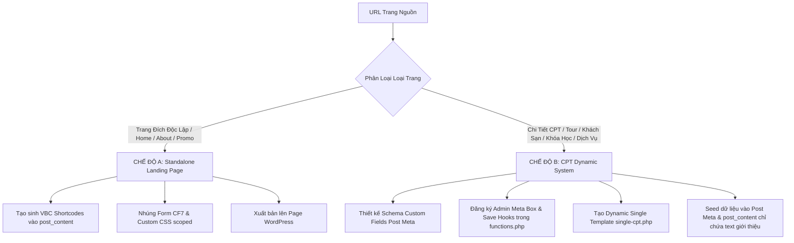

# Clone Landing Page & CPT System (Antigravity Real Browser & AI Visual Generative Architecture)

## Mục tiêu (Goal)
Sử dụng **Trình duyệt thật của Antigravity (`browser_subagent`)** để truy cập, cuộn trang kích hoạt hiệu ứng/lazy-load và chụp ảnh màn hình toàn trang (**Full-Page Screenshot**). 
Sau đó, **AI đóng vai trò Senior UI/UX & Fullstack WordPress Engineer** phân tích loại trang, trực tiếp quan sát ảnh chụp màn hình toàn trang để **TẠO SINH 100% MÃ NGUỒN MỚI TINH (Generative AI from Visual)**:
- Đối với **Trang đích độc lập (Landing Page)**: Tạo sinh hệ thống **Native VBC Elements** (`[vbc_section]`, `[row]`, `[col]`, `[vbc_div]`, `[vbc_box]`, `[vbc_block]`, `[vbc_container]`, `[vbc_h1]-[vbc_h6]`, `[vbc_p]`, `[vbc_a]`, `[vbc_img]`, `[vbc_icon]`, `[vbc_post]`, `[contact-form-7]`).
- Đối với **Hệ thống CPT & Trang Chi Tiết (Custom Post Type System)**: Thiết kế toàn diện kiến trúc **Backend (Custom Fields Schema, Admin Meta Box, REST API)** kết hợp **Frontend (Dynamic PHP Template `single-[cpt].php`, 5-Photo Mosaic Gallery, Sticky Booking Card, Timeline)**, tuyệt đối không dùng nội dung tĩnh.

> [!CRITICAL]
> **QUY TẮC CỐT LÕI — 100% SỬ DỤNG UX ELEMENTS & VBC ELEMENTS, TUYỆT ĐỐI CẤM DỒN CODE VÀO UX TEXT**:
> - ❌ **TUYỆT ĐỐI CẤM (HARD BAN) dồn toàn bộ nội dung HTML thô (`<div>...</div>`) vào `post_content` của Page hoặc UX Block!**
>   - Khi bạn dồn raw HTML vào `post_content`, trình dựng Flatsome UX Builder **KHÔNG THỂ** phân tích cấu trúc cây phần tử, và sẽ tự động gói toàn bộ cục HTML đó thành **MỘT PHẦN TỬ TEXT DUY NHẤT** trên thanh điều hướng bên trái!
>   - Người dùng mở UX Builder ra chỉ thấy đúng 1 nút Text màu xanh lè, không có Section, không có Row, không có Column, không thể kéo thả sắp xếp, không thể co giãn độ rộng cột hay click trực quan vào từng tiêu đề/nút bấm để chỉnh sửa!
> - ✅ **LUÔN LUÔN PHÂN RÃ TOÀN BỘ BỐ CỤC THÀNH CÂY PHẦN TỬ UX BUILDER & VBC ELEMENTS**:
>   - Mọi phân khu (Hero, Features, Content, Footer...) **BẮT BUỘC** dùng `[section]` hoặc `[vbc_section]`.
>   - Mọi cấu trúc chia cột **BẮT BUỘC** dùng `[row]` và `[col span="..."]`.
>   - Mọi khối bao, icon, container con **BẮT BUỘC** dùng `[vbc_div]`, `[vbc_box]`, `[vbc_block]`.
>   - Mọi tiêu đề dùng `[vbc_h1]` đến `[vbc_h6]` (hoặc `[title]`).
>   - Mọi đoạn văn bản dùng `[vbc_p]`.
>   - Mọi nút bấm, link điều hướng dùng `[vbc_a]` hoặc `[button]`.
>   - Mọi danh sách bài viết / CPT dùng `[vbc_post]`.
>   - Mọi form thu thập thông tin dùng `[contact-form-7]`.
>   - **Tiêu chuẩn nghiệm thu**: Khi mở trang hoặc UX Block trong UX Builder, thanh cây thư mục bên trái **BẮT BUỘC PHẢI THẤY ĐẦY ĐỦ CÂY PHÂN CẤP** (Section > Row > Column > Elements con). Nếu chỉ thấy 1 node `Text`, task bị tính là **THẤT BẠI HOÀN TOÀN**!


---

## 🏛️ Hai Chế Độ Kiến Trúc (Dual Architecture Strategy)

Trước khi thực hiện, AI Agent **BẮT BUỘC** phân loại trang nguồn thuộc một trong hai chế độ kiến trúc sau:



### Chế độ A: Standalone Landing Page (Trang Đích Độc Lập)
- **Áp dụng cho**: Trang chủ (Homepage), Trang giới thiệu công ty, Trang bảng giá tổng hợp, Trang sự kiện khuyến mãi đơn lẻ.
- **Đặc điểm**: Bố cục trang là duy nhất, toàn bộ cấu trúc được sinh trực tiếp dưới dạng VBC Elements lưu trong `post_content` của một WordPress Page.

### Chế độ B: CPT Dynamic System (Hệ Thống CPT & Trang Chi Tiết)
- **Áp dụng cho**: Chi tiết Tour du lịch, Phòng khách sạn, Bất động sản, Khóa học, Gói dịch vụ y tế/spa, Sản phẩm đặc thù.
- **QUY TẮC SỐNG CÒN — TUYỆT ĐỐI CẤM**:
  - ❌ **CẤM nhồi nhét toàn bộ giao diện chi tiết (bộ ảnh, bảng giá, lịch trình, sidebar, nút đặt, đánh giá) thành một chuỗi HTML/shortcode tĩnh cứng ngắc vào `post_content` của một bài viết đơn lẻ!**
  - Làm như vậy sẽ khiến các bài viết còn lại trong CPT bị trống trơn, hỏng giao diện, và người quản trị trong WP Admin không thể chỉnh sửa giá hay thuộc tính.
- **QUY TRÌNH CHUẨN 4 BƯỚC CHO CHẾ ĐỘ B**:
  1. **Backend Schema**: Tự động thiết kế bộ Custom Fields (`_tour_*`, `_item_*`) đáp ứng đầy đủ thuộc tính của đối tượng.
  2. **Admin Meta Box**: Tự động tạo giao diện nhập liệu trực quan trong WP Admin (`add_meta_box`) và hook lưu dữ liệu (`save_post_[cpt]`) an toàn.
  3. **Frontend Dynamic Template**: Viết file template PHP động cho child theme (`single-[cpt].php`) đọc toàn bộ Custom Fields qua `get_post_meta()` với fallback thông minh.
  4. **Clean Editorial Content**: `post_content` chỉ chứa văn bản giới thiệu/editorial thuần túy từ trình soạn thảo WordPress. Mọi bài viết thuộc CPT đều tự động thừa hưởng giao diện chuẩn đẹp 100%.

---

## Quy trình Thực hiện Chi tiết (Workflow)

### Bước 1: Điều khiển Trình Duyệt Thật Antigravity (`browser_subagent`) & Đồng Bộ Media
1. **Khởi chạy Trình duyệt thật qua Antigravity `browser_subagent`**:
   - Sử dụng tool `browser_subagent` để mở trình duyệt thật (Real Browser) điều hướng đến `<URL_NGUON>`.
   - Mô phỏng hành vi người dùng thật: cuộn trang từ từ từ trên xuống dưới để kích hoạt toàn bộ cơ chế **Lazy Load ảnh**, **Web Fonts**, **CSS Animations** và các thành phần JavaScript động.
   - Chụp ảnh màn hình toàn trang (**Full-Page Screenshot**) lưu vào `tmp/<slug>/source_screenshot.png` hoặc thư mục artifacts.
   - Trình duyệt Antigravity tự động ghi hình phiên duyệt web dưới dạng video WebP phục vụ kiểm chứng trực quan.

2. **Đồng bộ Media lên WordPress Media Library**:
   - Chạy script đồng bộ ảnh:
     ```bash
     python .agents/skills/clone-landingpage/scripts/sync_media.py --url "<URL_NGUON>"
     ```
   - **Quy tắc Kiểm tra Trùng lặp trước khi upload**: Script tự động kiểm tra ảnh đã tồn tại trên WordPress Media Library hay chưa (`/vbc/v1/check-media`). Nếu đã có $\to$ tái sử dụng URL WordPress, không tạo bản sao thừa. Kết quả ánh xạ lưu tại `tmp/<slug>/media_map.json`.

---

### Bước 2 (Chế độ B): Thiết Kế Schema Custom Fields & Admin Meta Box (Backend)

Khi xác định trang nguồn thuộc **Chế độ B (CPT Dynamic System)**:

#### 1. Bóc tách Schema Custom Fields chuẩn Klook/Travel/Service (`_tour_*` hoặc `_[cpt]_*`):
- **Giá & Khuyến mãi**: `_tour_price` (giá bán), `_tour_original_price` (giá gốc niêm yết gạch ngang), `_tour_discount_percent` (tiết kiệm %), `_tour_price_note` (ghi chú giá trọn gói).
- **Social Proof & Huy hiệu**: `_tour_badge` (Huy hiệu Klook), `_tour_rating` (sao đánh giá), `_tour_reviews_count` (số lượt đánh giá), `_tour_booked_count` (số lượt đặt).
- **Thông số dịch vụ**: `_tour_duration` (thời lượng), `_tour_location` (địa điểm), `_tour_languages` (ngôn ngữ HDV), `_tour_confirmation` (thời gian xác nhận vé), `_tour_cancellation` (chính sách hủy).
- **Thư viện ảnh Klook**: `_tour_gallery` (lưu danh sách 4 URL ảnh phụ ghép cùng ảnh đại diện Featured Image tạo thành bộ 5 ảnh mosaic).
- **Khối nội dung có cấu trúc**:
  - `_tour_highlights`: Điểm nổi bật (danh sách bullet points, mỗi dòng 1 gạch đầu dòng).
  - `_tour_packages`: Các gói dịch vụ sẵn có (định dạng `Tên gói | Giá | Mô tả`, mỗi dòng 1 gói).
  - `_tour_itinerary`: Trục thời gian lịch trình (định dạng `Thời gian | Hoạt động | Mô tả chi tiết`).
  - `_tour_included` & `_tour_excluded`: Dịch vụ bao gồm & không bao gồm.
  - `_tour_reviews_list`: Nhận xét khách hàng thực tế (`Họ tên (Nơi ở) | Số sao | Nội dung`).

#### 2. Đăng ký Admin Meta Box trong `functions.php`:
Tích hợp giao diện quản trị trực quan trong trang chỉnh sửa bài viết của WP Admin:
```php
add_action('add_meta_boxes', function() {
    add_meta_box('klook_tour_meta_box', '⚡ Thuộc tính Tour & Hoạt động (Custom Fields)', 'klook_render_tour_meta_box', 'tour', 'normal', 'high');
});

function klook_render_tour_meta_box($post) {
    wp_nonce_field('klook_save_tour_meta_action', 'klook_tour_meta_nonce');
    // Hiển thị các trường input/textarea chia theo từng section trực quan:
    // 1. Giá & Khuyến mãi | 2. Đánh giá & Huy hiệu | 3. Thông số | 4. Gallery | 5. Highlights | 6. Packages | 7. Itinerary | 8. Inclusions | 9. Reviews
}

add_action('save_post_tour', function($post_id) {
    if (!isset($_POST['klook_tour_meta_nonce']) || !wp_verify_nonce($_POST['klook_tour_meta_nonce'], 'klook_save_tour_meta_action')) return;
    if (defined('DOING_AUTOSAVE') && DOING_AUTOSAVE) return;
    if (!current_user_can('edit_post', $post_id)) return;
    // Sanitize và update_post_meta toàn bộ các trường
});
```

---

### Bước 3 (Chế độ B): Xây Dựng Template Động `single-[cpt].php` (Frontend)

Tạo file `single-[cpt].php` (ví dụ `single-tour.php`) trong child theme với cấu trúc chuẩn Klook:
1. **Breadcrumbs**: Điều hướng thông minh theo Điểm đến & Danh mục.
2. **5-Photo Mosaic Gallery**: Khung 432px height (1 ảnh lớn 60% bên trái + lưới 2x2 ảnh phụ 40% bên phải + floating button đếm ảnh).
3. **Thanh Fast Facts**: Icon & thông tin nhanh (Xác nhận tức thời, Hủy miễn phí, Ngôn ngữ, Xe riêng).
4. **Điểm Nổi Bật (Highlights)**: Danh sách tích cam Klook nổi bật.
5. **Giới Thiệu Hoạt Động**: Render `the_content()` lấy trực tiếp từ trình soạn thảo WordPress.
6. **Các Gói Dịch Vụ Sẵn Có (Packages)**: Khung lựa chọn gói với giá riêng và nút chọn.
7. **Lịch Trình Chi Tiết (Itinerary Timeline)**: Trục thời gian dọc với vạch nối và chấm tròn cam Klook.
8. **Điều Khoản Dịch Vụ**: 2 bảng so sánh trực quan Bao gồm (tick xanh) vs Không bao gồm (chữ thập đỏ).
9. **Đánh Giá Khách Hàng**: Các thẻ nhận xét thật kèm sao vàng 5.0.
10. **Sticky Booking Sidebar**: Khung giá cố định bên phải khi cuộn trang, hiển thị giá ưu đãi, % tiết kiệm, nút cam *"Đặt Ngay • Giữ Chỗ Tức Thì"*, form giữ chỗ CF7 và các huy hiệu bảo đảm.
11. **Gợi Ý Tương Tự (Related Items)**: Tự động truy vấn 3 item liên quan ngẫu nhiên từ cơ sở dữ liệu ở chân trang.

---

### Bước 4: Tự động Tạo Biểu Mẫu Contact Form 7 (BẮT BUỘC)
Khi phát hiện form nhập liệu trên trang nguồn (hoặc khu vực CTA đăng ký nhận ưu đãi/tư vấn/đặt chỗ):
1. **Phân tích các trường dữ liệu**: Bóc tách tên trường, placeholder, kiểu input (Họ tên, SĐT, Email, Khóa học/Tour, Ngày khởi hành, Số lượng khách, Ghi chú...).
2. **Chạy script sinh Form CF7 qua REST API**:
   ```bash
   python .agents/skills/clone-landingpage/scripts/create_cf7.py --title "Form Đặt Dịch Vụ - <Tên Landing Page>" --fields "name,phone,email,tour_date,guests,note" --button "Đặt Ngay • Giữ Chỗ Tức Thì"
   ```
3. **Lấy mã Shortcode trả về** dạng `[contact-form-7 id="<ID>" title="..."]` để nhúng trực tiếp vào container VBC hoặc Sidebar.
4. **Quy tắc**: 100% biểu mẫu thu thập thông tin (Lead Form) **BẮT BUỘC** phải được tạo thành form Contact Form 7 thực tế qua API, **TUYỆT ĐỐI KHÔNG** dùng văn bản giả lập tĩnh (`[vbc_p]`) thay cho form.

---

### Bước 4.1: Nhận Diện Danh Sách Bài Viết (Blog) & Sản Phẩm/Tour -> Dùng `[vbc_post]`
Khi phát hiện khu vực danh sách Tin tức, Bài viết Blog, Kiến thức, hoặc Danh sách Tour/Sản phẩm:
1. **Nhận diện dạng Row / Grid Blog (Tin tức / Kiến thức)**:
   - **BẮT BUỘC sử dụng element `[vbc_post]`** với `post_type="post"` để hiển thị danh sách bài viết chuẩn WordPress động.
   - Cú pháp chuẩn:
     ```
     [vbc_post post_type="post" posts_per_page="3" columns="3" columns__sm="1" layout="grid" image_height="220px" title_tag="h3" button_text="Xem chi tiết" card_radius="18px"]
     ```
2. **Nhận diện dạng Row / Grid Tour / Hoạt Động / Sản Phẩm**:
   - Sử dụng `[vbc_post]` với `post_type="tour"` (hoặc `post_type="product"`):
     ```
     [vbc_post post_type="tour" posts_per_page="4" columns="4" columns__sm="1" layout="grid" card_radius="16px"]
     ```
3. **Ưu điểm**: Tự động lấy ảnh đại diện, tiêu đề, tóm tắt, giá bán, ngày đăng, liên kết permalink tự động và tương thích 100% với Flatsome UX Builder.

---

### Bước 4.2: Tách & Clone Footer Về Flatsome UX Block Footer (Global UX Block Footer)

> [!CRITICAL]
> **QUY TẮC BẮT BUỘC VỀ FOOTER**:
> - ❌ **TUYỆT ĐỐI CẤM dán trực tiếp footer vào `post_content` của từng trang Landing Page hay CPT.** Nếu làm vậy, mỗi khi khách hàng sửa thông tin công ty hay hotline, họ phải vào sửa từng trang một.
> - ❌ **KHÔNG hardcode footer tĩnh trong file `footer.php`** vì sẽ làm mất khả năng kéo thả, chỉnh sửa trực quan của Flatsome UX Builder.
> - ✅ **LUÔN LUÔN tạo một Flatsome UX Block (`post_type: 'blocks'`) với slug là `footer` (hoặc `klook-footer`)**. Flatsome hỗ trợ sẵn cơ chế gán UX Block làm Footer toàn trang (`theme_mod: 'footer_block'`), giúp toàn bộ website (Trang chủ, Điểm đến, Chi tiết Tour, Danh sách Blog, Chi tiết bài viết) đều tự động dùng chung một chân trang chuẩn đẹp và có thể mở UX Builder chỉnh sửa trực quan 100%!

#### 1. Bóc Tách & Thiết Kế Cấu Trúc Footer Chuẩn Klook / Modern E-commerce:
Footer cao cấp cần được phân tách thành 3 phân khu rõ ràng:
1. **Thanh Cam Kết Giá Trị (Value Propositions / Brand Pillars)**:
   - 4 khối lợi ích nổi bật: *Vô vàn lựa chọn*, *Chơi vui giá tốt*, *Dễ dàng và tiện lợi*, *Đáng tin cậy*.
   - Icon sinh động (background bo tròn pastel: `#fff5eb`, `#e6f7ff`, `#f6ffed`), tiêu đề đậm (16px, `#1e293b`), nội dung cam kết (13px, `#64748b`).
2. **Khối Liên Kết Đa Cột & Tiện Ích Chân Trang (4 Columns Grid)**:
   - **Cột 1 (Về thương hiệu)**: Về chúng tôi, Klook Blog, Điểm đến nổi bật, Mã giảm giá, Thẻ quà tặng, Du lịch bền vững.
   - **Cột 2 (Đối tác)**: Đăng ký nhà cung cấp, Đối tác đăng nhập, Tiếp thị liên kết (Affiliate), Creator, Đại lý.
   - **Cột 3 (Điều khoản)**: Điều khoản sử dụng, Chính sách bảo mật, Chính sách Cookie, Hoàn hủy vé, Phúc lợi động vật.
   - **Cột 4 (Kênh thanh toán & App)**:
     - Lưới badge thẻ thanh toán: MoMo, VISA, MasterCard, JCB, AMEX, UnionPay, ATM, Apple Pay, Google Pay (badge trắng viền xám mềm mại).
     - Cụm Tải Ứng Dụng: Nút đen bo góc App Store và Google Play, QR Code tải nhanh, ưu đãi 5% cho đơn đầu trên App.
   - *Lưu ý kỹ thuật*: Sử dụng `display: flex; flex-direction: column; gap: 10px;` cho danh sách link thay vì thẻ `<ul>/<li>` để triệt tiêu hoàn toàn nguy cơ dính bullet dot hoặc gạch đầu dòng do CSS theme Flatsome áp đặt.
3. **Thanh Bản Quyền & Mạng Xã Hội (Copyright & Social Bar)**:
   - Dòng bản quyền: `© 2014-2026 Klook Travel Technology Limited. All Rights Reserved. • Clone by Antigravity VibeCode`.
   - Cụm nút mạng xã hội hình tròn: Facebook, Instagram, TikTok, Threads, YouTube có hiệu ứng scale khi hover.

#### 2. Khởi Tạo UX Block Bằng 100% UX & VBC Elements:
> [!IMPORTANT]
> **TUYỆT ĐỐI KHÔNG LƯU RAW HTML**: Nội dung `$footer_content` bắt buộc phải là chuỗi shortcode phân cấp `[section]`, `[row]`, `[col]`, `[vbc_div]`, `[vbc_box]`, `[vbc_h4]`, `[vbc_p]`, `[vbc_a]`. Nếu lưu chuỗi thẻ `<div>`, UX Builder sẽ gom toàn bộ thành 1 thẻ Text duy nhất làm tê liệt khả năng kéo thả!

Tạo bản ghi trong bảng `wp_posts`:
```php
$block_id = wp_insert_post(array(
    'post_title'   => 'Footer',
    'post_name'    => 'footer',
    'post_type'    => 'blocks',
    'post_status'  => 'publish',
    'post_content' => $footer_shortcodes, // 100% [section], [row], [col], [vbc_...]
));
```

#### 3. Kích Hoạt Footer Toàn Trang & Ẩn Footer Mặc Định Trong `functions.php`:
Trong `flatsome-child/functions.php`, thêm các filter để Flatsome tự động gọi UX Block `footer` cho mọi trang và loại bỏ thanh bản quyền mặc định của Flatsome:
```php
/**
 * Global Footer UX Block Integration
 */
add_filter('theme_mod_footer_block', function($block) {
    return 'footer'; // Khớp với slug của UX Block
});

// Vô hiệu hóa widget chân trang mặc định của Flatsome
add_filter('theme_mod_footer_1', '__return_false');
add_filter('theme_mod_footer_2', '__return_false');

// Ẩn thanh absolute-footer mặc định của Flatsome (vì đã có trong UX Block)
add_action('wp_head', function() {
    echo "<style id=\"vbc-footer-styles\">
        #footer { background: #ffffff !important; padding: 0 !important; }
        #footer .footer-wrapper { background: #ffffff !important; padding: 0 !important; }
        #footer .absolute-footer { display: none !important; }
        .klook-footer-wrapper a { color: #64748b !important; text-decoration: none !important; transition: color 0.15s ease !important; }
        .klook-footer-wrapper a:hover { color: #ff5b00 !important; text-decoration: underline !important; }
    </style>\n";
}, 9999);
```

---

### Bước 5: Thư Viện Micro-Components & Design Patterns Cao Cấp (Aesthetic Tokens)

> [!TIP]
> Để website clone đạt được sự choáng ngợp (WOW effect) và giống web gốc 100%, áp dụng các component pattern đã được chuẩn hóa:

#### 1. Bố cục 5-Photo Mosaic Gallery (Klook/Airbnb chuẩn 432px height)
```html
<div class="klook-mosaic-gallery" style="margin-bottom: 30px; border-radius: 16px; overflow: hidden; height: 432px; max-height: 432px; display: flex; gap: 8px; position: relative;">
  <!-- Ảnh lớn bên trái (60%) -->
  <div style="flex: 0 0 calc(60% - 4px); height: 100%; position: relative; overflow: hidden; cursor: pointer;">
    
  </div>
  <!-- Lưới 2x2 ảnh nhỏ bên phải (40%) -->
  <div style="flex: 0 0 calc(40% - 4px); height: 100%; display: grid; grid-template-columns: repeat(2, 1fr); grid-template-rows: repeat(2, 212px); gap: 8px;">
    <div style="overflow: hidden;"></div>
    <div style="overflow: hidden;"></div>
    <div style="overflow: hidden;"></div>
    <div style="overflow: hidden;"></div>
  </div>
  <!-- Floating Button -->
  <button style="position: absolute; bottom: 16px; right: 16px; background: rgba(255,255,255,0.95); backdrop-filter: blur(8px); border: none; padding: 9px 18px; border-radius: 8px; font-weight: 700; font-size: 13px; cursor: pointer; box-shadow: 0 4px 16px rgba(0,0,0,0.18);">
    Thư viện ảnh (5)
  </button>
</div>
```

#### 2. Thẻ Voucher Coupon Cutouts (Vết khuyết bán nguyệt & Cuống vé)
```css
.klook-voucher-card {
  position: relative;
  background: #ffffff;
  border-radius: 16px;
  overflow: hidden;
  box-shadow: 0 6px 20px rgba(0,0,0,0.05);
}
/* Vết khuyết xé vé bán nguyệt 2 bên */
.klook-voucher-divider {
  position: relative;
  border-top: 2px dashed #e2e8f0;
  margin: 16px 0;
}
.klook-voucher-divider::before,
.klook-voucher-divider::after {
  content: '';
  position: absolute;
  top: -10px;
  width: 20px;
  height: 20px;
  background: #f5f6f8; /* Khớp với màu nền trang */
  border-radius: 50%;
}
.klook-voucher-divider::before { left: -26px; }
.klook-voucher-divider::after { right: -26px; }
```

#### 3. Sticky Booking Sidebar
```html
<div style="position: sticky; top: 90px; background: #ffffff; border-radius: 20px; padding: 28px; border: 1px solid #ebebeb; box-shadow: 0 12px 35px rgba(0,0,0,0.08);">
  <div style="background:#fff4eb; color:#ff5b00; font-size:12px; font-weight:800; padding:4px 12px; border-radius:20px; display:inline-block; margin-bottom:12px;">ƯU ĐÃI ĐẶC BIỆT HÔM NAY</div>
  <div style="display:flex; align-items:baseline; gap:10px; margin-bottom:6px;">
    <span style="font-size:32px; font-weight:900; color:#ff5b00;">₫ 780.000</span>
    <span style="font-size:15px; color:#94a3b8; text-decoration:line-through;">₫ 950.000</span>
    <span style="background:#fff0eb; color:#ff5b00; font-size:11px; font-weight:700; padding:2px 8px; border-radius:4px;">Tiết kiệm 18%</span>
  </div>
  <a href="#book-form" style="display:block; width:100%; background:#ff5b00; color:#ffffff; text-align:center; padding:15px; border-radius:12px; font-weight:800; font-size:16px; text-decoration:none; box-shadow:0 4px 15px rgba(255,91,0,0.3);">Đặt Ngay &bull; Giữ Chỗ Tức Thì</a>
  [contact-form-7 id="..." title="..."]
</div>
```

---

### Bước 6: Cơ Chế Vượt Cache Nginx Tuyệt Đối (Zero-Cache Strategy)

> [!WARNING]
> Trên các hệ thống máy chủ WordPress Nginx/Cloudflare, các tài nguyên tĩnh (`style.css`) thường bị cache cứng tới 1 năm (`max-age=31536000`). Trình duyệt người dùng sẽ từ chối tải lại file tĩnh dẫn đến layout vỡ hoặc giao diện cũ rích dù code đã sửa!

**Quy tắc bắt buộc thực hiện trong `flatsome-child/functions.php`**:
```php
/**
 * Print child style.css inline into <head> to completely bypass any Nginx/browser static asset cache
 */
add_action('wp_head', function() {
    $css_file = get_stylesheet_directory() . '/style.css';
    if (file_exists($css_file)) {
        echo "\n<!-- VBC Brand Core UI CSS (Zero Cache) -->\n<style id=\"vbc-brand-styles\">\n" . file_get_contents($css_file) . "\n</style>\n";
    }
}, 9999);
```
Nhờ cơ chế này, mọi thay đổi về CSS lõi, Voucher Ticket, Gallery Mosaic đều có hiệu lực ngay lập tức 100% khi người dùng F5.

---

### Bước 7: Xuất bản & Đối Soát Đa Điểm (Multi-Item Visual Verification)

1. **Xuất bản qua REST API**:
   - Đối với Landing Page: Sử dụng `publisher.py`.
   - Đối với CPT System: Sử dụng endpoint `/klook/v1/create-item` hoặc script nạp Post Meta tự động cho toàn bộ các item.

2. **Quy Trình Kiểm Tra & Đối Soát Trực Quan Đa Điểm (BẮT BUỘC)**:
   - **Với Standalone Page**: Sử dụng `browser_subagent` và `rechecker.py` kiểm định VSI $\ge 90\%$.
   - **Với CPT System**: **BẮT BUỘC mở ít nhất 2–3 bài viết/tour khác nhau** trên trình duyệt thật `browser_subagent` để chụp ảnh màn hình xác nhận:
     - Item 1 hiển thị đúng ảnh và giá của Item 1.
     - Item 2 hiển thị đúng ảnh và giá của Item 2.
     - Template động hoạt động trơn tru, không có hiện tượng dữ liệu tĩnh bị ghi đè.
     - 0 Shortcodes chưa parse.
     - Tương thích 100% với trình kéo thả Flatsome UX Builder.
